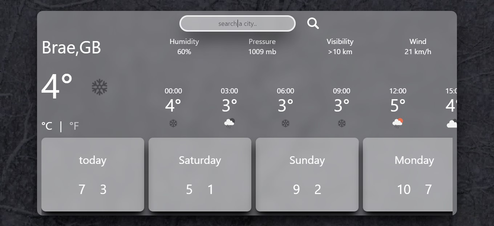

# <p align="center">Real-time Weather App</p>

<p align="center">
  
</p>

## About
This is a web application that provides weather forecasts for specific geographic locations. It utilizes the OpenWeatherMap API to fetch weather data and employs web technologies like HTML, Tailwind CSS, and JavaScript to display this information interactively.

## Features
- **Interactive UI:** Search for cities and view weather information in an easy-to-use interface.
- **Weather Details:** Display current temperature, weather icon, humidity, atmospheric pressure, visibility, and wind speed.
- **Forecasts:** View the weather forecast for the next 24 hours in a graphical format.
- **Custom Styling:** Background video with a semi-transparent overlay and a styled search box with shadow and blur effects.
- **Mouse Wheel Scrolling:** Horizontally scroll through forecast blocks using the mouse wheel.

## How It Works
1. **Search Functionality:** Users enter a city name in the input field and click the search button.
2. **Data Fetching:** An asynchronous function (`getData()`) makes API requests to OpenWeatherMap to retrieve weather data based on the city name.
3. **Data Processing:** The returned JSON data includes information such as temperature, humidity, pressure, visibility, wind speed, and forecasts for the next few hours and days.
4. **Temperature Conversion:** Temperatures are converted from Kelvin to Celsius and Fahrenheit.
5. **Dynamic Display:** Weather icons and temperature data are dynamically updated in the user interface.

## Installation
1. Clone the repository:
   ```bash
   git clone https://github.com/Halid04/Real-time-Weather-app.git
   ```
2. Navigate to the project directory:
   ```bash
   cd Real-time-Weather-app
   ```

## Usage
1. Open `index.html` in your preferred web browser.
2. Enter the name of a city in the search field and click the search button to view the weather forecast.

## Limitations
- **Responsiveness:** This web app is not responsive and may not function correctly on mobile devices.
- **API Limits:** The OpenWeatherMap API has usage limits that may affect the availability of data.

## More Info
The application allows users to scroll horizontally through weather forecast blocks using the mouse wheel. Event listeners are set up to handle the mouse wheel events, preventing default scrolling behavior and enabling horizontal movement of elements based on the `deltaY` event.
